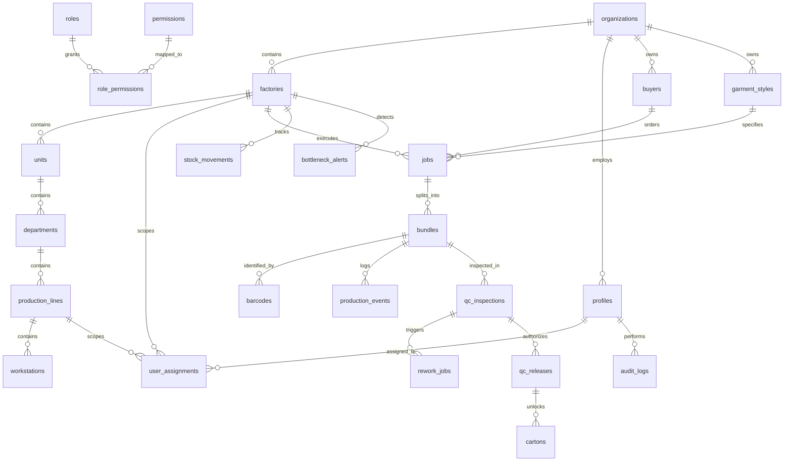
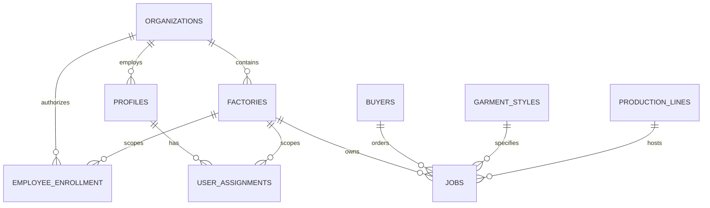
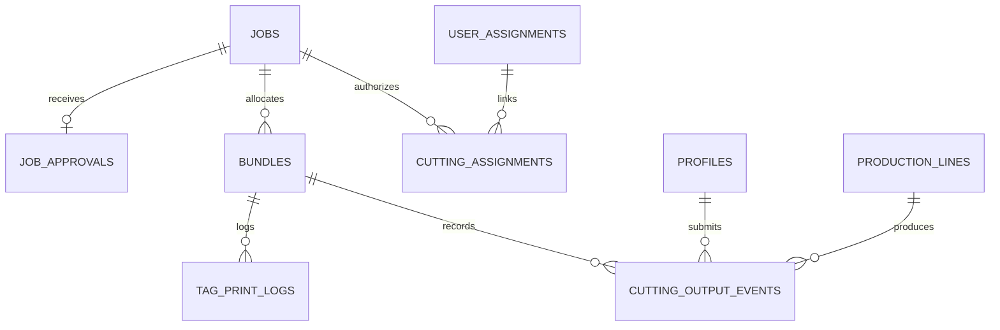

# StitchFlow — PostgreSQL Database Schema & ER Model

## 1. Entity Relationship Diagram

## 2. Phase 1 Core Tables (`supabase/migrations/202611260001_phase1_org_auth_audit.sql`)

| Table | Purpose | Key Constraints |
|---|---|---|
| `organizations` | Top-level garment group tenant | `id UUID PK`, `code UNIQUE`, `is_active` |
| `factories` | Manufacturing plants under an organization | `organization_id FK`, `UNIQUE(organization_id, code)` |
| `units` | Factory units | `factory_id FK`, `UNIQUE(factory_id, code)` |
| `departments` | Cutting, Sewing, Finishing, QC, Store, Packing | `unit_id FK`, `UNIQUE(unit_id, code)` |
| `production_lines` | Sewing/production lines | `department_id FK`, `factory_id FK`, `capacity INT CHECK (>0)` |
| `workstations` | Individual stations/machines on a line | `line_id FK`, `UNIQUE(line_id, code)` |
| `shifts` | Morning, Afternoon, Night shifts | `factory_id FK`, `shift_type CHECK` |
| `roles` | 7 canonical roles (`md`, `factory-manager`, `supervisor`, `operator`, `qc-inspector`, `store-dispatch`, `packing-staff`) | `code PK` |
| `permissions` | 13+ granular permission keys | `code PK` |
| `role_permissions` | Role-to-permission join table | `PK(role_code, permission_code)` |
| `profiles` | Employee profile linked to `auth.users(id)` | `UNIQUE(organization_id, employee_id)`, `account_status IN ('pending','active','suspended','rejected')` |
| `user_assignments` | Scopes an employee to factory, unit, department, line, shift | `profile_id FK`, `factory_id FK`, `line_id FK` |
| `audit_logs` | Append-only immutable activity & security log | `actor_id FK`, `action`, `entity_type`, `entity_id`, `previous_values JSONB`, `new_values JSONB` |

## Enrollment schema extension

Employee enrollment has a composite primary key on organization and employee ID, a unique organization/email pair, an eligible factory and an active flag. The enrollment table has RLS and no direct mobile access. Registration additionally verifies that the active factory belongs to the same active organization.

## Approval, bundles and confirmed cutting

Job approvals hold a single decided outcome per job. Bundles reference the approved job, use a globally unique barcode and link a stable request UUID to each allocation. Tag reprint log rows reference the unchanged bundle. Cutting assignments link a job to an active hierarchical employee assignment. Cutting output is an append-only event with separate actor and producing line IDs, recorded shift and server time. An actor-scoped request UUID prevents duplicate output. There is no stock movement associated with a cutting output record.

## Cut-stock storage and handovers

Storage locations belong to a factory and have a unique code there. Cut-stock handovers link a bundle with an active location and, for Output Out, a destination line. The API performs factory and assignment checks against the organization. Sender request IDs are unique. Immutable settled rows retain quantities and sender/receiver evidence. Pending receipts do not create stock. Output Out uses confirmed receipts less pending, accepted and disputed issues. Disputes preserve the reservation for a later authorized reconciliation flow.

## Routed production records

A job has ordered route steps and explicit employee assignments. Stage events are unique per bundle and route step and append-only. Quality events are append-only and update the per-bundle balance in the same transaction. The balance enforces inspected = passed + rejected + rework + held, completed rework bounded by the rework queue, and release bounded by passed quantity. Cartons reserve released quantities with a stable request ID and retain an immutable packing record. A separate immutable Store receipt precedes dispatch approval and execution.

## Close policy, allocation and evidence storage

The immutable job_items table sets per-size/color quantities. The optional draft job_close_policies entry defines the allowed rejected count and audit reason. cut_stock_discrepancy_returns records the original sender's verified full return and a separate approving manager. The existing handover remains immutable and available quantity is released only once the return has an approval timestamp.

garment_measurement_specs stores millimeter limits by style, garment size and measurement point. bundle_measurements records actor, observed value, whether tolerance passed and a request UUID. bundle_quality_photos contains metadata and content hash; the bytes are stored in the private stitchflow-qc-evidence Storage bucket. The restrictive Storage policy excludes the bucket from direct authenticated and anonymous operations. Authorized server reads mint a short-lived signed URL.

## Ledger and dispatch extension

Raw material catalog entries use integer piece, millimeter or gram units. The append-only ledger records receipts, issues, movements in transit, destination receipts, fully verified returns and count adjustments. A physical count has an observed quantity and book snapshot and can be adjusted only through a separate approving Factory Manager. Disputes retain destination observations; the original sender can return the full verified quantity to source.

The bundle_route_progress view derives cumulative step completion and currently available quantity from confirmed prior input. Repeated partial events have stable request IDs. A shipment manifest reserves one or more recorded cartons, records separate approval and execution actors, and retains a gate-pass reference while writing individual carton settlements.
